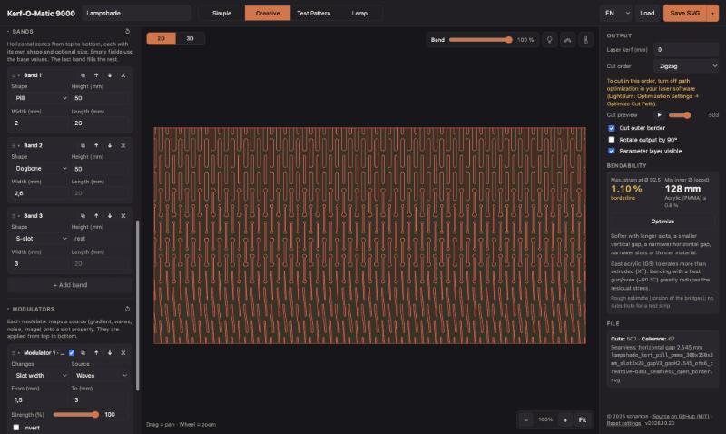
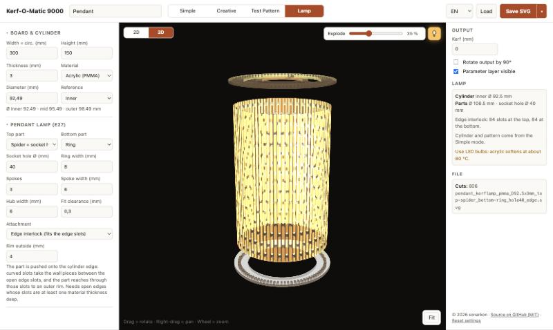
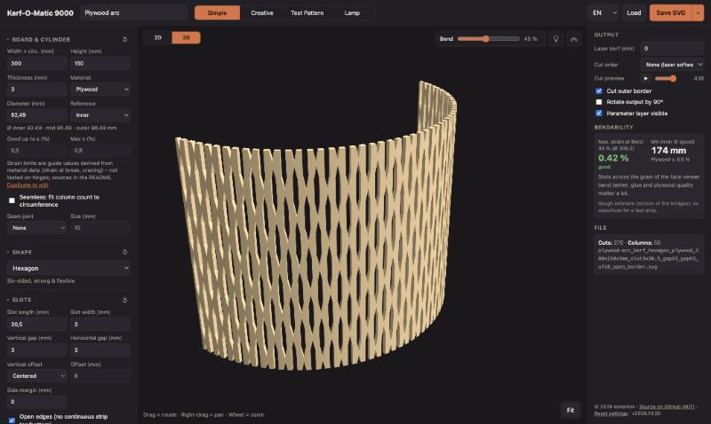

# Kerf-O-Matic 9000

A browser tool for laser-cut kerf bending (living hinge) patterns, made for **cylinders and pendant lampshades**. Everything is metric and runs in a single HTML file – no install, no build step, nothing is uploaded.

**Live:** https://sonarkon.github.io/Kerf-O-Matic-9000/

## Contents

- [Quick start](#quick-start)
- [Modes](#modes) – Simple · Creative · Test Pattern · Lamp
- [Board and cylinder](#board-and-cylinder)
- [Preview](#preview)
- [Bendability estimate](#bendability-estimate) · [Material limits](#material-limits)
- [Export and files](#export-and-files)
- [Tips for acrylic](#tips-for-acrylic)
- [Run locally](#run-locally) · [Credits](#credits) · [License](#license)

## Quick start

1. Enter the **width (= circumference)** and **height** of the board – or the diameter you want, and the width is calculated.
2. Choose the **material** and its **thickness**, then a **shape** and the **slot** values.
3. Check the **bendability** on the right and the preview (try *3D* and the lamp button).
4. Cut a few strips in **Test Pattern** mode to find the right values for your material.
5. **Save SVG** and cut. For a lamp, switch to **Lamp** and save the complete cut set.

Every section has a **↺** button that resets just that section to its defaults (for example only the lamp settings); *Reset settings* at the bottom resets everything.

## Modes

| Mode | What it is for |
|---|---|
| **Simple** | One even pattern across the board. |
| **Creative** | Bands and modulators for lampshade designs on the same slot grid. |
| **Test Pattern** | A set of labelled test strips that vary one value. |
| **Lamp** | The parts for a pendant lamp (E27) around the Simple/Creative shade. |

### Simple

- **Shapes:** pill (one closed path with true arcs), **dogbone** (round relief holes at the slot ends), **S-slot** (constant width, exact arcs), line, meander, ellipse, rectangle, diamond, hexagon, chevron, cross.
- **Slots:** length, width, vertical and horizontal gap.
- **Vertical offset:** top-aligned, centered (top and bottom edges mirror each other) or a custom value.

### Creative

Everything from Simple, plus per-slot variation on the same grid, so the shade still bends evenly:

- **Bands** – horizontal zones from top to bottom, each with its own shape and optional slot size (mix pill, dogbone, S-slot …).
- **Modulators** – a source drives a slot property:
  - sources: linear gradient (any angle, optionally mirrored), radial, waves, noise, or a greyscale **image**;
  - targets: slot width, slot length, remove slots, swap the shape;
  - they stack from top to bottom with adjustable strength.
- Drag a band or modulator by its header to reorder it (or use ↑ / ↓); click the header to collapse or expand it.
- ⧉ duplicates a band or modulator; the checkbox in a modulator's header switches it off for a moment without deleting it.
- With **Seamless** on, radial, waves and noise wrap around the cylinder, so the design continues across the glue seam.
- **Image source:**
  - *Stretch*, *Fit* (no distortion), *Fill* (cropped) or *Tile* (whole tiles around the cylinder with *Seamless*); outside a fitted image the modulator has no effect.
  - A preview in the board's proportions shows the image as it reaches the pattern (levels, blur, invert) – drag it to move it, use the wheel or the *Size* slider to scale it.
  - *Levels*: a histogram of the image with markers for black point, mid-tones (gamma) and white point – drag them to spread a flat photo over the full range; double-click resets.
  - *Blur* (mm) smooths out single pixels.
- Strength, threshold, angle, phase and the radial centre are sliders with their value next to them.
- An image is stored (downscaled) with the design, so it reloads completely.

### Test Pattern

- Strips that vary one value (horizontal gap, slot length, vertical gap or slot width) from *From* to *To*; *Count* can also be 1.
- Each strip is engraved with the varied value, all slot values (`Pill L 20 W 2 Gap V 4 H 2`) and the project name – lines shrink to fit, and wrap on short strips.
- The panel lists the smallest inner diameter per strip that should stay within the material's “good” range.

### Lamp

Parts for a **pendant lamp with an E27 socket** around the shade from Simple or Creative (whichever was used last):

- **Parts:** a list like the bands – by default a spider at the top and a ring at the bottom. Each part is a spider with socket hole, disc with socket hole, disc or ring, sits at the top or bottom and can be moved inward by an **offset**; add more parts (for example stiffening rings in long lamps), drag, collapse, duplicate or delete them. The socket hole defaults to Ø 40 mm (E27 shade ring – check yours, 40–42 mm is common).
- **Adjustable:** spokes, spoke and hub width, ring width, fit clearance; kerf compensation applies.
- **Attachment** – set per part. At the end (offset 0):
  - **Glued in** – the part sits inside the cylinder.
  - **Tabs & slots** – the shade gets tabs on that edge (edge slots under a tab are left out); the part sits on the end with matching slots. The tabs also appear in the Simple/Creative shade file while *Cut Lamp tabs* (under Output) is on – turn it off when you are not making a lamp. The Lamp mode always adds them.
  - **Edge interlock** – no extra tabs: the part gets curved slots on the wall's exact curvature for the wall pieces between the open edge slots and reach through those slots to an outer rim. Needs open edges whose slots are at least one material thickness deep.
- **With an offset** the part sits inside the tube (no outer rim) and is either **glued in** – *Engrave part positions on the shade* (under Output) engraves a dashed line where each one goes – or held by **tabs through the wall**: the part gets tabs reaching through matching slots cut into the shade; the pattern keeps solid material around those slots (rigid in the Flex view).
- … or by **fingers in the pattern slots**: one finger in every pattern slot (pill, rectangle, dogbone) whose straight part spans the part's height. They keep the part centred, but the slots are longer than the part is thick, so it can slide – the panel reminds you to glue it as well, and warns about fingers narrower than 1.5 mm.
- The panel warns when a part leaves the shade or two parts overlap.
- **2D view and SVG** contain the complete cut set – the flat shade plus the parts, engraved with number, end and offset (e.g. `3 TOP 60`).
- **3D view** shows the assembled lamp with the light at the socket; the **Explode** slider lifts the parts off.
- **STL/OBJ** export the whole assembly.

## Board and cylinder

- **Cylinder sizing:** enter the inner, mid-plane or outer diameter; the width (circumference) is calculated on the material's mid-plane.
- **Seamless:** adjusts the horizontal gap so an even number of columns fills the circumference – the pattern continues across the glue seam.
- **Seam joint:** a glue tab past the circumference, or finger joints (fingers on one edge, matching notches on the other).
- **Open edges:** slots run out through the top and bottom edges, so no continuous solid strip is left.
- **Kerf compensation:** slots are drawn smaller and the outline larger by half the laser kerf, so the cut part has the nominal size.
- **Cut order:** zigzag, or every other column first (less heat build-up – useful for acrylic).
- Side margins, optional outer border, 90° rotated output.

## Preview

- **2D / 3D** switch at the top left.
- At the top right:
  - **Bend** (Simple/Creative) – from flat to a closed cylinder; also used for the bendability estimate and the STL/OBJ export.
  - **Explode** (Lamp, 3D) – lifts the lamp parts off the shade.
  - **Lamp** – glowing slots on a dark background, in 2D and 3D.
  - **Flex** – strain heatmap per slot: good / borderline / too high / rigid.
- **3D** shows the extruded part with its real thickness – the same closed solid as the STL/OBJ export. Acrylic is semi-transparent, wood is opaque. Drag to orbit, right-drag to pan, wheel to zoom. three.js is loaded only when 3D is opened.

## Bendability estimate

Strain in the twisting bridges between the slot columns, computed for every slot-to-slot link and scaled with **Bend** (100 % = closed cylinder, 50 % = half the curvature). The panel shows the maximum strain and the smallest inner diameter that stays “good” for the chosen material.

It is a rough guide based on Saint-Venant torsion and does not replace a test cut.

**Lamp tabs:** with open edges, the edge slots under each tab are left out, so the wall stays solid there. The Flex view shows that zone as rigid – opaque as deep as no column has a slot, then fading out where only some columns are solid – and the panel names the flat facet it forms (≈ tab width² ÷ (4 × diameter)).

**Optimize** appears when the strain is borderline or too high. It lengthens the slots just enough to reach “good” (up to half the board height, as long as the slots still interlock) and, if that is not enough, shortens the vertical gap (down to 1.5 mm). In Creative mode, band slot lengths and slot-length modulators scale along. Thickness and diameter are never changed. The panel lists what was changed, with **Undo**; if “good” is out of reach, it names the inner diameter that would work.

**Thickness** enters in two ways:

- **Bridge cross-section** (the main effect): each bridge is a small bar, as wide as the gap between the slot columns and as thick as the material. In torsion the *shorter* side of that cross-section governs the strain. While the material is thinner than the bridge is wide, the strain grows almost in proportion to the thickness; once it is thicker, the bridge width governs and more thickness adds little strain – the shade mainly gets stiffer.
- **Reference diameter**: everything is computed on the mid-plane (inner Ø + thickness), which links the width (circumference) to the diameter.

Example with the default pattern (2 mm bridges, inner Ø 44.7 mm, acrylic):

| Thickness | Strain | Smallest “good” inner Ø |
|---|---|---|
| 1 mm | 0.98 % | 57 mm |
| 2 mm | 1.42 % | 83 mm |
| 3 mm | 1.78 % | 103 mm |
| 4 mm | 1.95 % | 112 mm |
| 6 mm | 2.06 % | 117 mm |

Not modelled: forces – how hard the shade is to bend and how strongly it springs back – which grow with thickness.

### Material limits

Each material has two strain limits: up to **good** the hinge should bend reliably, up to **max** it is borderline, and above that it will probably crack. The limits are shown under *Material*.

| Material | Good ≤ | Max | Reference point |
|---|---|---|---|
| Acrylic (PMMA) | 0.8 % | 1.5 % | breaks at about 4–6 % (cast, datasheets¹); craze tests bend it to 0.5–1 %² |
| Plywood | 0.5 % | 0.8 % | breaks at about 0.75–0.8 % (bending strength ÷ stiffness³) |
| MDF | 0.4 % | 0.8 % | breaks at about 0.85–1.1 % (bending strength ÷ stiffness³ ⁵); fibres bond only weakly, so twisted bridges fray |

**These are estimates, not tested hinge values.** They are derived from published material data: the limits stay below the strain at break and, for acrylic, near the strain where crazing (fine cracks) becomes a concern. No source gives allowable strains for laser-cut hinges directly, and the data come from bending tests, while the bridges of a hinge twist. Grade (cast vs. extruded acrylic), plywood quality and glue, grain direction (slots across the face grain bend better), temperature and the laser settings all change the real limit. In practice wood is also more forgiving than acrylic, which is brittle and sensitive to notches.

Sources:
1. Cast PMMA datasheets: [APSO PMMA GS](https://www.apsoparts.com/media/downloads/asset//std.lang.all/0_/en/PMMA-GS_00_007-00_EN.pdf) (4 %, ISO 527), [Polycast](https://modernplastics.com//wp-content/uploads/2015/03/Polycast-Perfume-Resistant.pdf) (6 %, ASTM D638)
2. Solvent-crazing test at 0.5 / 1.0 % outer-fibre strain: [J-STAGE](https://www.jstage.jst.go.jp/browse/koron1944/23/257/_contents)
3. Modulus of rupture and elasticity of wood-based panels: [Journal of Wood Science](https://jwoodscience.springeropen.com/articles/10.1007/s10086-017-1632-5/tables/4)
4. Torsion design of lattice hinges (acrylic data from MatWeb, 60 % of the torsional yield stress for repeated bending): [DefProc](http://marksabino.com/defproc/blog/2011/laser-cut-lattice-living-hinges/)
5. MDF datasheets (EN 622-5 minimum values for thin boards: 23 N/mm², 2700 N/mm²): [Kastamonu MEDEPAN](https://www.kastamonuentegre.com/uploads/2023/01/004-ts-eng-001-2-medepan-technical-specifications.pdf), [Swiss Krono](https://www.swisskrono.com/pl-en/products/interiors/mdf-boards/technical-data/), [Pfleiderer](https://www.pfleiderer.com/file_pim/Dokumente/technical-data-styleboard-mdf-plus-im0016459.pdf)

**Own materials:** *Duplicate to edit* copies the selected material; you can then rename it and set your own limits – ideally calibrated with a few [test strips](#test-pattern): bend each strip to a known diameter and note where it starts to crack. Own materials are kept in the browser and saved with every design, so a loaded SVG/OBJ/PNG brings its material along.

PETG is not offered: it melts and smears under a CO₂ laser instead of cutting cleanly.

## Export and files

The **Save** button exports in the format chosen from its menu:

| Format | Content |
|---|---|
| **SVG** | The cut file for the laser (true size in mm). |
| **STL** / **OBJ** | A closed 3D solid with real thickness, bent as set with *Bend* (Lamp: the whole assembly). Zero-width cuts get a 0.2 mm kerf; OBJ has welded vertices for Blender. The bend follows the circle within 0.01 mm, so small parts for 3D printing come out round too. |
| **PNG** | A mask texture (white = material, black = hole), the size in mm in the file name. Simple: a seamless, square 2048 px tile of the pattern. Creative: when the design only changes from top to bottom (bands, gradients and waves at 90°), a stripe of two columns over the full height that repeats around the cylinder (`_stripe_`); otherwise the whole board (`_texture_`, seamless around with *Seamless* on). |

**All parameters are saved with the design** – in the file name, as a *Parameters* layer and as metadata. **Load** restores a design from a saved SVG, OBJ or PNG (STL cannot hold the parameters). An optional **project name** becomes the file-name prefix and the first line of the parameter layer.

### SVG layers

| Layer | Colour | Use |
|---|---|---|
| Cuts | red | cut |
| Outer border | red | cut |
| Engrave | black | engrave (labels on test strips and lamp parts) |
| Parameters | blue | information only – turn its output off in your laser software, or save with the layer hidden |

## Tips for acrylic

- Cast acrylic (GS) tolerates more bending than extruded (XT).
- Bending with a heat gun or in an oven (~90 °C) greatly reduces the residual stress.
- Round slot ends (pill, dogbone) are less prone to cracking than pointed ones.
- Use **LED bulbs** in acrylic lamps – acrylic softens at about 80 °C (Lamp mode shows this next to the bendability values).
- Cut a few test strips first; the bendability estimate is only a guide.

## Run locally

Open `index.html` in any modern browser. The 3D view and the STL/OBJ export load small libraries from a CDN on first use; everything else works offline.

## Credits

Inspired by [KerfSmith](https://kerfsmith.com/web-app.html).

## License

MIT – see [LICENSE](LICENSE).
