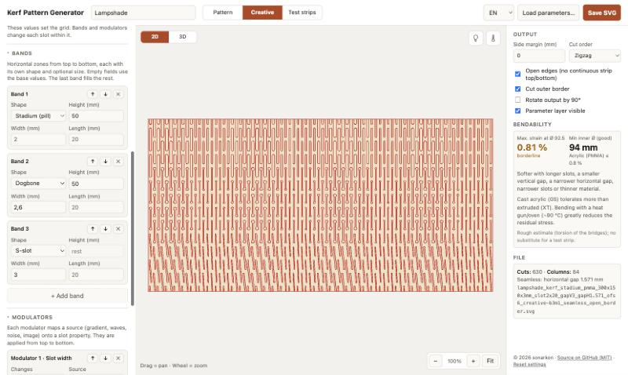

# Kerf Pattern Generator

A browser tool for laser-cut kerf bending (living hinge) patterns, with a focus on **cylinders**. It runs as a single HTML file: no install, no build step, and nothing is uploaded.

**Live:** https://sonarkon.github.io/Kerf-Pattern-Generator/

## Features

- **Metric** throughout; SVG export in mm, at true size.
- **Stadium / pill slots** as one closed path with true arcs, not a rectangle plus two overlapping circles.
- **Cylinder sizing**: enter the inner, mid-plane or outer diameter and the board width (circumference) is calculated on the material's mid-plane.
- **Seamless mode**: adjusts the horizontal pitch to an even number of columns, so the pattern continues across the glue seam without a break.
- **Open edges**: slots run out through the top and bottom edges, so no continuous solid strip is left.
- **Vertical offset**: top-aligned, centered (top and bottom mirror each other) or a custom value.
- **Gradient**: horizontal gap or slot length varies left → right or center → edges.
- **Bendability estimate**: strain in the twisting bridges for the target diameter, plus the smallest recommended diameter per material (acrylic, PETG, plywood, MDF). It is a rough guide based on Saint-Venant torsion and does not replace a test cut.
- **Test strips**: a set of coupons that vary one parameter, each with an engraved label (value and min. diameter).
- **Cut order**: zigzag, or every other column first (less heat build-up, useful for acrylic).
- Side margins, optional outer border, 90° rotated output.
- **All parameters saved in the file**: in the file name, as a separate *Parameters* layer, and as metadata. *Load parameters…* restores everything from a saved SVG.
- Shapes: stadium, **dogbone** (round relief holes at the slot ends), **S-slot** (constant width, exact arcs), line, meander, ellipse, rectangle, diamond, hexagon, chevron, cross.
- English and German UI.

## SVG layers

| Layer | Colour | Use |
|---|---|---|
| Cuts | red | cut |
| Outer border | red | cut |
| Engrave | black | engrave (test-strip labels) |
| Parameters | blue | info only – turn output off in your laser software, or save with the layer hidden |

## Run locally

Open `index.html` in any modern browser.

## Credits

Inspired by [KerfSmith](https://kerfsmith.com/web-app.html).

## License

MIT – see [LICENSE](LICENSE).
