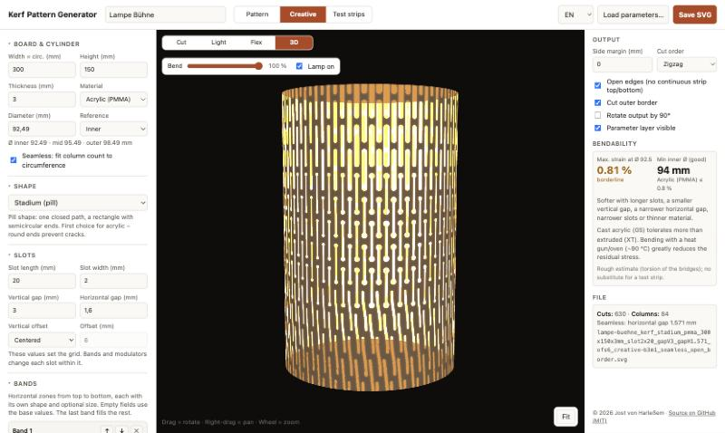

# Kerf Pattern Generator

A browser tool for laser-cut kerf bending (living hinge) patterns, with a focus on **cylinders**. It runs as a single HTML file: no install, no build step, and nothing is uploaded.

**Live:** https://sonarkon.github.io/Kerf-Pattern-Generator/

## Features

- **Metric** throughout; SVG export in mm, at true size.
- **Stadium / pill slots** as one closed path with true arcs, not a rectangle plus two overlapping circles.
- **Cylinder sizing**: enter the inner, mid-plane or outer diameter and the board width (circumference) is calculated on the material's mid-plane.
- **Seamless mode**: adjusts the horizontal pitch to an even number of columns, so the pattern continues across the glue seam without a break.
- **Open edges**: slots run out through the top and bottom edges, so no continuous solid strip is left.
- **Vertical offset**: top-aligned, centered (top and bottom mirror each other) or a custom value.
- **Creative mode** for lampshades and other designs, on top of the same slot grid:
  - **Bands**: horizontal zones, each with its own shape and optional slot size (mix pill, dogbone, S-slot …).
  - **Modulators**: linear gradient (any angle, optionally mirrored), radial, waves, noise or a greyscale **image** drive slot width, slot length, slot removal or a shape swap. They stack from top to bottom with adjustable strength.
  - The image is stored (downscaled) in the SVG metadata, so a design can be reloaded completely.
- **Preview**: *2D* or *3D*, with two overlay buttons at the top right: **lamp** (glowing slots on a dark board – how a lampshade will look) and **flex heatmap** (strain per slot: good / borderline / too high / rigid). Both work in 2D and 3D.
- **3D preview** with the real material thickness: outer and inner surface, walls along every slot, rims and edges. A *Bend* slider goes from flat to a closed cylinder; acrylic and PETG are semi-transparent, wood is opaque; orbit and zoom with the mouse. three.js is loaded only when the 3D view is opened.
- **Bendability estimate**: strain in the twisting bridges for the target diameter, computed for every slot-to-slot link, plus the smallest recommended diameter per material (acrylic, PETG, plywood, MDF). It is a rough guide based on Saint-Venant torsion and does not replace a test cut.
- **Test strips**: a set of coupons that vary one parameter, each with an engraved label (value and min. diameter).
- **Cut order**: zigzag, or every other column first (less heat build-up, useful for acrylic).
- Side margins, optional outer border, 90° rotated output.
- **All parameters saved in the file**: in the file name, as a separate *Parameters* layer, and as metadata. *Load parameters…* restores everything from a saved SVG.
- Optional **project name**: used as the file-name prefix and as the first line of the parameter layer.
- Shapes: stadium, **dogbone** (round relief holes at the slot ends), **S-slot** (constant width, exact arcs), line, meander, ellipse, rectangle, diamond, hexagon, chevron, cross.
- English and German UI.

## SVG layers

| Layer | Colour | Use |
|---|---|---|
| Cuts | red | cut |
| Outer border | red | cut |
| Engrave | black | engrave (test-strip labels) |
| Parameters | blue | info only – turn output off in your laser software, or save with the layer hidden |

## Run locally

Open `index.html` in any modern browser.

## Credits

Inspired by [KerfSmith](https://kerfsmith.com/web-app.html).

## License

MIT – see [LICENSE](LICENSE).
